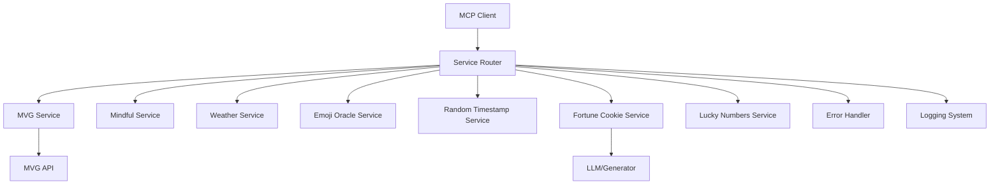

# Design Document

## Overview

The multi-service MCP platform will transform the existing single-purpose MVG MCP server into a comprehensive service platform that hosts multiple utility services. The platform will maintain the existing MCP protocol compatibility while adding HTTP-based routing to support multiple services through a unified interface. Each service will be independently implemented but share common infrastructure for routing, error handling, and response formatting.

## Architecture

### High-Level Architecture



### Service Architecture Pattern

Each service will follow a consistent pattern:
- **Service Interface**: Common interface for all services
- **Service Implementation**: Specific logic for each service
- **Data Management**: State management for services requiring persistence
- **Response Formatting**: Consistent JSON response structure

### URL Routing Structure

The platform will support the URL pattern: `http(s)://<domain>/<service>/<version>`

Supported routes:
- `/mvg/v1` - Munich transport service
- `/mindful/v1` - Mindful sentences service
- `/weather/v1` - Optimistic weather forecast service
- `/emoji-oracle/v1` - Cryptic emoji messages service
- `/timestamp/v1` - Random timestamp generator service
- `/fortune/v1` - Digital fortune cookie service
- `/lucky-numbers/v1` - Mystical number generation service

## Components and Interfaces

### Core Components

#### 1. Service Router (`service_router.py`)
- **Purpose**: Route requests to appropriate services based on URL path
- **Responsibilities**:
  - Parse incoming requests and extract service/version information
  - Validate service availability and version compatibility
  - Forward requests to appropriate service handlers
  - Handle cross-cutting concerns (logging, error handling)

#### 2. Base Service Interface (`base_service.py`)
```python
class BaseService:
    async def handle_request(self, method: str, params: dict) -> dict
    def get_tools(self) -> list
    def get_service_info(self) -> dict
```

#### 3. Service Implementations

##### MVG Service (`services/mvg_service.py`)
- Maintains existing functionality
- Integrates with current `mcp_service.py` logic
- Tools: `get_departures`, `find_station`

##### Mindful Service (`services/mindful_service.py`)
- Manages pool of mindful sentences
- Tracks daily sentence distribution
- Tools: `get_mindful_sentence`

##### Weather Service (`services/weather_service.py`)
- Generates optimistic weather forecasts
- Always predicts pleasant conditions
- Tools: `get_weather_forecast`

##### Emoji Oracle Service (`services/emoji_oracle_service.py`)
- Maintains emoji symbol pool
- Generates cryptic 3-emoji combinations
- Tools: `get_emoji_oracle`

##### Random Timestamp Service (`services/timestamp_service.py`)
- Generates random timestamps within ranges
- Validates input parameters
- Tools: `generate_random_timestamp`

##### Fortune Cookie Service (`services/fortune_service.py`)
- Generates hourly surreal phrases
- Caches phrases per hour
- Tools: `get_fortune_cookie`

##### Lucky Numbers Service (`services/lucky_numbers_service.py`)
- Generates "statistically blessed" numbers for various scenarios
- Provides mystical explanations and cosmic alignment percentages
- Adjusts number ranges based on scenario context
- Supports 10 different scenario types with specialized methodologies
- Includes customizable parameters for count, range, and energy level
- Tools: `generate_blessed_numbers`

#### 4. Data Management (`data/`)

##### Sentence Pool (`data/mindful_sentences.py`)
- Contains 50+ mindful sentences
- Provides sentence selection logic

##### Emoji Pool (`data/emoji_symbols.py`)
- Categorized emoji collections
- Symbol combination logic

##### Fortune Generator (`data/fortune_generator.py`)
- Phrase generation templates
- Surreal content creation logic

##### Lucky Numbers Generator (`data/lucky_numbers_generator.py`)
- Scenario-specific number generation logic
- Mystical methodology explanations
- Cosmic alignment calculation

#### 5. Utilities (`utils/`)

##### Time Manager (`utils/time_manager.py`)
- Handles time-based operations
- Daily/hourly reset logic

##### Response Formatter (`utils/response_formatter.py`)
- Standardizes response formats
- Error response templates

## Data Models

### Service Request Model
```python
@dataclass
class ServiceRequest:
    service: str
    version: str
    method: str
    params: dict
    request_id: str
```

### Service Response Model
```python
@dataclass
class ServiceResponse:
    success: bool
    data: dict
    error: Optional[str]
    timestamp: datetime
```

### Service Registration Model
```python
@dataclass
class ServiceInfo:
    name: str
    version: str
    description: str
    tools: List[dict]
    status: str
```

## Error Handling

### Error Categories
1. **Service Not Found**: Invalid service name in URL
2. **Version Not Supported**: Invalid version number
3. **Method Not Found**: Invalid MCP method
4. **Parameter Validation**: Invalid or missing parameters
5. **Service Unavailable**: Internal service errors
6. **Rate Limiting**: Too many requests (future enhancement)

### Error Response Format
```json
{
  "jsonrpc": "2.0",
  "id": "request_id",
  "error": {
    "code": -32601,
    "message": "Service not found",
    "data": {
      "service": "invalid_service",
      "available_services": ["mvg", "mindful", "weather", "emoji-oracle", "timestamp", "fortune"]
    }
  }
}
```

### Error Handling Strategy
- Graceful degradation for service failures
- Detailed logging for debugging
- User-friendly error messages
- Fallback responses where appropriate

## Testing Strategy

### Unit Testing
- Individual service logic testing
- Data model validation testing
- Utility function testing
- Error handling testing

### Integration Testing
- Service router functionality
- End-to-end request/response flow
- MCP protocol compliance
- Service interaction testing

### Test Structure
```
tests/
├── unit/
│   ├── test_services/
│   ├── test_utils/
│   └── test_data/
├── integration/
│   ├── test_service_router.py
│   └── test_mcp_compliance.py
└── fixtures/
    ├── sample_requests.json
    └── expected_responses.json
```

### Testing Tools
- `pytest` for test framework
- `pytest-asyncio` for async testing
- `unittest.mock` for mocking external dependencies
- Custom fixtures for MCP protocol testing

### Test Coverage Goals
- Minimum 90% code coverage
- All error paths tested
- All service endpoints tested
- MCP protocol compliance verified

## Performance Considerations

### Caching Strategy
- Fortune cookie phrases cached per hour
- Mindful sentences cached per day
- Weather forecasts cached for reasonable periods

### Resource Management
- Async/await pattern for non-blocking operations
- Connection pooling for external APIs
- Memory-efficient data structures

### Scalability
- Stateless service design where possible
- Configurable service limits
- Modular service architecture for easy scaling

## Security Considerations

### Input Validation
- Parameter sanitization for all inputs
- Type checking and range validation
- Protection against injection attacks

### Rate Limiting
- Per-service request limits (future enhancement)
- IP-based throttling (future enhancement)

### Data Privacy
- No persistent storage of user data
- Minimal logging of sensitive information
- Secure handling of any cached data

## Configuration Management

### Service Configuration
```python
# config/services.yaml
services:
  mvg:
    enabled: true
    version: "1.0.0"
    rate_limit: 100
  mindful:
    enabled: true
    version: "1.0.0"
    sentences_per_day: 4
  # ... other services
```

### Environment Variables
- `MCP_LOG_LEVEL`: Logging level
- `MCP_CACHE_TTL`: Cache time-to-live
- `MCP_MAX_REQUESTS`: Request limits

## Deployment Considerations

### Packaging
- Maintain existing MCP server entry point
- Add new multi-service entry point
- Backward compatibility with existing installations

### Dependencies
- Minimal additional dependencies
- Optional dependencies for enhanced features
- Clear dependency management in `pyproject.toml`

### Migration Path
- Existing MVG functionality remains unchanged
- New services added incrementally
- Configuration-driven service enablement